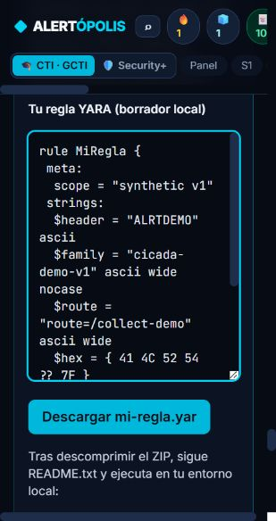

# Verificación de las ampliaciones prácticas

Fecha: 19-10-2026. Ejecución local en Windows, build de producción servido bajo
`/ticourse/` y HashRouter. Alcance y fuentes en
[practical-curriculum.md](../practical-curriculum.md).

## Resultados

| Verificación | Resultado |
|---|---|
| `npm test -- --reporter=dot` | 14 archivos, 162 pruebas aprobadas |
| `npm run build` | Exit 0; TypeScript + Vite + limpieza de audio completados |
| YARA real: `verify.py` | libyara/yara-python 4.5.4; 12/12 expectativas del corpus conformes |
| Regla escrita y descargada desde el editor | `MiRegla` compilada y ejecutada con YARA real; 12/12 expectativas conformes |
| `scripts/test-yara-practice.py` | 5/5: referencias, regla amplia rechazada, sobreajuste detectado, error de sintaxis distinguido y ZIP extraído ejecutable de forma independiente |
| `scripts/package-yara-practice.py --check` | ZIP coincide con cinco fuentes, doce fixtures y manifiesto |
| Distribución del ZIP en el build | HTTP 200 y hash igual al archivo validado |
| `git diff --check` | Exit 0, sin errores de espacios en el diff |

La suite de compatibilidad comprueba IDs y orden de módulos, bloques originales
en sus índices, bancos de preguntas conservados, pesos de ambos tracks, 120
preguntas de nivel, enlaces internos y documentación primaria. El estado
persistido y las migraciones conservan su implementación y sus pruebas.

Los tests del store en Node emiten sus avisos habituales de localStorage no
disponible; las 162 pruebas pasan. Vite informa de un bundle de aproximadamente
1,97 MB y del aviso de chunks superiores a 500 kB; no bloquea el build. No se ha
incluido una refactorización del empaquetado en esta ampliación de contenido.

El servidor de desarrollo encontró un error del watcher al recorrer un
worktree de vídeo preexistente. La verificación funcional se realizó con
`vite preview` del build de producción, que funcionó correctamente; no se
modificaron los worktrees de vídeo para resolver esa limitación del entorno.

## Recorrido en interfaz

Sobre el build se respondieron los **16 checkpoints nuevos**, repartidos entre
sp4m8, sp2m6, sp4m10, s3m1, s3m2, s3m3, s3m4, s3m5, s4m2, s4m4 y s5m3. Todos
mostraron feedback correcto. También se probó una decisión incorrecta del caso
de feeds: elegir Eco por precio mostró la explicación de coste total y valor
incremental.

En s3m5 se comprobó explícitamente que una respuesta complementaria deja el
contador obligatorio en **0/4**. Tras responder los cuatro checkpoints base se
habilita «Completar lección» aunque quede práctica complementaria sin responder.

Se escribió una regla completa en el editor, se abrió la solución comentada y
se descargó `mi-regla.yar`. Ese archivo se contrastó con el verificador local:
detecta A/B/C y rechaza el resto bajo el alcance v1. El navegador no compila la
regla, no solicita cuentas y no recibe tokens o credenciales.

YARA Forge mantiene sus cuatro muestras de etiquetas y el estado de progreso.
Seleccionando s1/s2/s3 y el umbral de dos, la simulación detecta sus dos variantes
y rechaza ambos controles. El resultado dice «Objetivo de la simulación
cumplido» y declara que no demuestra calidad de producción.

Se verificaron el enlace visible de sp4m8 hacia sp4m10, el cambio de track por
ruta y la búsqueda «escritura libre», que devuelve la lección s3m5 y YARA Forge.
El editor se inspeccionó en la vista estrecha del navegador. No se observaron
errores de consola en el recorrido.

Se revisaron además las transcripciones de s3m2 y sp4m8. Sus simplificaciones
grabadas tienen ahora notas editoriales junto al vídeo y al inicio de la
transcripción. El audio, sus URLs y los índices de bloque se conservaron.

## Límites de lo verificado

El corpus es sintético e inerte. «12/12» incluye resultados negativos esperados y
un caso fuera del alcance, no representa detección perfecta de una familia
real. La variante v2 y archivos fuera del tamaño pactado siguen documentados
como límites/FN si se amplía el objetivo.

Las consultas VirusTotal se contrastaron con su documentación oficial; no se
ejecutaron búsquedas avanzadas ni se usaron licencias. El flujo de Microsoft se
verificó contra documentación oficial y ejercicios ficticios, sin operar una
cuenta real. Esta entrega es local; no se ha publicado en GitHub Pages.
